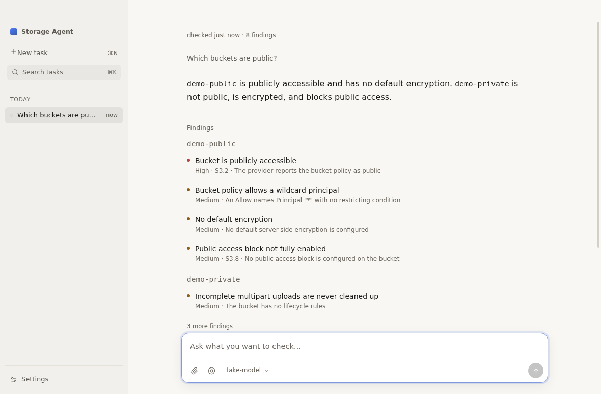

# Storage Agent

A local agent for object storage. You ask a question about your S3-compatible
accounts; it reads them read-only, remembers what it saw, and answers with a
brief: a verdict, the findings it proved, the evidence and a fix. It never
writes, deletes or changes anything in storage.



## What it does

- Surveys an account of up to 5,000 buckets: reads every bucket's policy, ACL,
  public access block, TLS policy, ownership, CORS, logging, encryption and
  lifecycle once, plus the account-wide public access block and — on AWS —
  CloudWatch capacity with a monthly storage estimate. It remembers each bucket
  as it is read and decides twelve deterministic rules, mapped to AWS Security
  Hub controls where they match exactly.
- Answers questions no fixed check can — the largest prefixes, data untouched
  for two years, versions piling up — by writing a short read-only script that
  runs in a sandbox with no network, files or process; the rows become the page
  and the script stays as the evidence.
- Evaluates bucket policies locally, so an S3-compatible store without AWS's
  policy-status API can still be proved public — or proved narrowed by a
  network or organization condition.
- Says a question is open when a read was denied or unsupported, instead of
  pretending it is clean, and shows the blind spot on the page.
- After you apply a fix, re-reads just that bucket and shows what the task
  proved fixed. A risk you accept folds away until a reading proves it gone.
- Lists objects, versions and incomplete uploads; inspects one object's metadata,
  tags, ACL and a bounded text preview.
- Generates fixes as text — AWS CLI, Terraform and the API document — with an
  impact preview built only from what the estate already knows.
- Reads access paths: bucket policy and ACL locally, all IAM users and roles and
  their policies with `GetAccountAuthorizationDetails`, inherited SCPs, KMS key
  policy and Access Analyzer findings. Identity grants are intersected with
  bucket-policy Denies; action/resource forms are paired and ARNs are matched
  case-sensitively. Coverage, undecided conditions and truncation are shown; a
  blind read is named, never turned into an empty grant list.
- **Check account** on Home runs the survey and access reads without a model or
  an API key. On a first run it adds demo storage and writes a deterministic
  brief, so the product can prove itself before any model is configured.
- Compares each survey with the last remembered posture and, on AWS, asks
  CloudTrail who changed it over a stated 90-day window. A denied lookup leaves
  the actor unknown.
- Re-verifies a task without a model: it re-reads the buckets the task touched
  and reports what changed. Findings, controls, timestamps and redacted views
  export as an evidence pack; the brief saves as PDF.
- Imports an attached access log or S3 Inventory through code mode (`dataset`,
  `aggregate`, `inventory`, `principal`); a full inventory can be imported file
  by file, and raw rows never reach the model.
- Shows each tool call where it happens, with real progress, and keeps it as
  the receipt behind every finding; every table can be copied as CSV or saved,
  the whole brief as Markdown. Every bucket the answer names is checked against
  what the tools returned, and so is every claim that a bucket is or is not
  public.
- Starts without setup: **Check account** adds demo storage on first run and
  works without a model; models already running on this machine (Ollama, LM
  Studio) are one click away. Home is a quiet account summary, not a dashboard,
  with no suggestion pills or follow-up prompts. `@` points at a remembered
  account, bucket or issue; the names are focus, not authorization.
- Sets the model in one step: paste a key and the provider's models are fetched,
  the context window is inferred and reasoning is automatic. A small model gets
  shorter method cards and a smaller tool budget.
- Searches task titles, requests, findings and the current answer with ⌘K;
  failed or stopped runs offer Retry or Continue.

## Shape

One window, one brief, one composer. The task list is the only navigation.
There is no storage page, no bucket browser, no dashboard and no settings
wizard: the agent resolves storage from the request, and Settings holds the
model and the accounts.

```text
┌──────────────────────────── Electron ────────────────────────────┐
│  renderer (React)                    main                        │
│  tasks · brief · composer     ⇄ IPC ⇄  pi-durable harness        │
│                                        ├ 10 read-only tools      │
│                                        ├ estate (rules/issues)   │
│                                        └ pi-ai → model           │
│                              one SQLite: pi_* + host tables      │
└──────────────────────────────────────────────────────────────────┘
```

- **Electron 45 + TypeScript + React 19**, no sidecar, no localhost HTTP.
- **pi-durable 1.4** for the durable agent loop: storage, resume, steering,
  abort, compaction and tool tasks.
- **pi-ai 1.4** for model access: OpenAI (Responses API, reasoning effort),
  Anthropic (thinking) and any OpenAI-compatible endpoint (Ollama, LM Studio,
  vLLM, OpenRouter). Prompt caching where the provider supports it.
- **Accounts** by sealed access keys or by AWS profile — SSO,
  `credential_process` and assume-role resolve through the AWS SDK.
- **One SQLite database** through Node's built-in `node:sqlite`; pi's tables are
  prefixed `pi_`. Each imported dataset is a separate SQLite file.
- **No native addons.** Nothing to rebuild, nothing to sign beyond the app.

## Development

```bash
npm ci
npm run dev          # Electron + Vite with HMR
npm run typecheck
npm run lint
npm test
npm run build
npm run budget       # first-paint bundle under 500 KiB
xvfb-run -a npm run perf  # cold start under 1 s
npm run audit
npm run sbom
npm run dist:dir     # unpacked app under release/
```

End-to-end against a fake S3 and a fake OpenAI-compatible model, and the agent
eval against a real model:

```bash
xvfb-run -a node scripts/e2e.mjs
xvfb-run -a node scripts/e2e-audit.mjs   # first run without a model
xvfb-run -a node scripts/shots.mjs       # screenshots under .amp/in/artifacts
EVAL_PROVIDER=anthropic EVAL_MODEL=… EVAL_API_KEY=… xvfb-run -a node scripts/eval.mjs
```

## Security

Secrets live in the OS keychain through Electron `safeStorage`, or — when no
keyring is available — in a local AES-256-GCM file with a 0600 key. SQLite holds
only ciphertext; a profile account holds only the profile name. Every tool is read-only. A provider's bucket scope is enforced
server-side before any call. Tool output reaches the model inside an
`<untrusted-data>` envelope, and credentials are redacted before anything is
stored, shown or sent. See [docs/security.md](docs/security.md).

## Deliberate omissions

Twelve rules are not a compliance scanner: they are the checks a reading can
decide without guessing intent.

No message editing or version trees, no Evidence side pane, no MCP bridge, no
user skills, no standing instructions, no subagents, no background watch, no S3
log download (attach the log instead), no write/apply action, no dashboard, no
second window and no import of the previous app's data. A fix is text the user
applies.

License: Apache-2.0.
