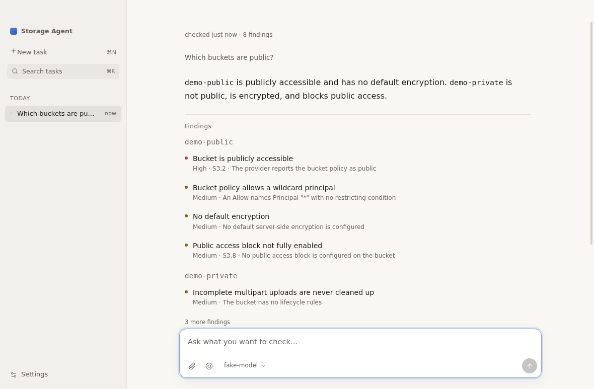

# Storage Agent

An agent that looks after S3-compatible object storage and the cloud around
it, on your own machine. You talk with the agent; it decides what to read, how
to investigate and what to say. It keeps what it learns in a workspace of its
own, works on a schedule when you ask it to watch something, and proposes
changes that run only when you approve them. A **task** is one conversation:
your messages and, between them, every tool call the agent made and what it
returned. The agent never changes storage itself.

Version in this tree: **43.0.0**.



## What it does

- **Reads what the services return.** `call` runs one read-only operation of a
  bundled AWS SDK client: S3, S3 Control, STS, IAM, Organizations, KMS, Access
  Analyzer, CloudWatch, CloudTrail, Config, CloudFront, Backup, Security Hub,
  GuardDuty, SNS and SQS: the storage and the account around it. Any operation
  named Get, List, Head, Describe, Lookup, Search, Select, Simulate or BatchGet
  runs. The response is JSON, or the service's error code, HTTP status
  and message.
- **Answers questions over many objects.** `query` runs a JavaScript script in
  a QuickJS sandbox. Its primitives include `call()` (object bodies come back
  whole), `read()`, `dataset()`, `inventory()`, `sql()`, `history()`,
  `discover()`, `workspace()`, `run()` (a workspace script) and `render()` (a
  view). It has no network, filesystem, process, timer or model access.
- **Analyzes data as it is.** `dataset()` imports an attached file, an object,
  or every object under a prefix (S3 server access logs, CSV, TSV, JSON lines,
  JSON, Parquet, plain lines) into a local SQLite table with every source
  column; `inventory()` imports an S3 Inventory report with the schema its
  manifest names. Nothing is dropped, masked or cut; the agent queries with
  SQL.
- **Keeps a workspace.** `workspace` is the agent's own folder across tasks:
  notes on your accounts and decisions, skills it wrote, kept datasets,
  scripts it can run again, views pinned on Home's board, files exported for
  you, and its own `db.sqlite`. You can open, edit or delete anything in it.
- **Works on a schedule.** `schedule` sets a prompt to run on its own — once,
  every few minutes or hours, daily or weekly — each run a turn in the
  schedule's own task, stopped at a token budget when nobody is watching.
  `notify` tells you what you need to know: a system notification and an
  entry in Home's inbox, once per run.
- **Proposes changes you approve.** On an account that allows changes,
  `change` proposes one reversible bucket-configuration write (public access
  blocks, policy, ownership, encryption, versioning, lifecycle, CORS, logging,
  tags, ACL). The app reads what it would replace first; you see the exact
  call, before and after, and **Approve** or **Reject**. Every applied change
  can be rolled back. Anything else the agent writes as text for you to apply.
- **Knows itself.** `self` tells the agent its model and window, what the task
  spent, the accounts and their settings and its schedules; it can rename or
  pin its task and propose an account's scope or allowing changes, which apply
  when you approve.
- **Delegates.** `delegate` gives a self-contained investigation to a child
  agent with the same tools, account scope and task files; its steps show live
  in the parent's step, several run at once, and a question it would ask comes
  back to the parent.
- **Reads anything it was given, again.** Every result is kept; `more` reads
  any stretch of a result, an object body, an attached file, a workspace file
  or a bundled skill, even after the conversation was compacted. An image is
  shown to a model that takes images.
- **Asks when it must.** `ask` puts a question in the conversation, with
  optional answer buttons.
- **Shows what the agent did.** Each tool call is a step where it happened.
  Opening it shows the shaped result and exactly what the agent received.
  Provider reasoning appears as `Thought` when the provider returns it. The
  agent may link a call as `[1](#ev-<id>)`; the link opens that step. The app
  adds no report, verdict, summary or next-step prompt.
- **Serves other agents.** `storage-agent --mcp` runs headless as an MCP
  server over stdio and serves `call`, `query`, `probe`, `more` and the
  workspace's read actions, with the same scope, redaction and envelope.
- **Uses the model you have.** OpenAI, Anthropic or an OpenAI-compatible
  endpoint; paste a key and the provider's models are fetched. Models running
  in Ollama or LM Studio are one click away.

## Shape

One window, one conversation per task, one composer. The task list is the
navigation; Home shows the accounts and what the agent keeps in front of you —
its inbox, its board and its schedules. Settings holds the model, accounts,
the workspace and appearance.

```text
┌──────────────────────────── Electron ────────────────────────────┐
│ renderer (React, sandboxed)        main                          │
│ tasks · Home (inbox, board, ⇄ IPC ⇄  pi-durable harness          │
│ schedules) · conversation ·             ├ call · query · probe   │
│ change cards · composer                 ├ more · workspace · self│
│                                         ├ schedule · notify      │
│                                         ├ change · delegate · ask│
│                                         ├ s3/api (any read)      │
│                                         ├ approvals (writes)     │
│                                         └ pi-ai → model          │
│                              one SQLite: pi_* + host tables      │
│                              workspace/ · tasks/<id>/ files      │
│ storage-agent --mcp: call · query · probe · more · workspace     │
└──────────────────────────────────────────────────────────────────┘
```

- **Electron 45, TypeScript, React 19.** No sidecar, no HTTP server, no native
  addon.
- **pi-durable 1.5** owns the durable loop: storage, resume, steering, abort,
  compaction, tool tasks, the schedules' timers and per-run hooks.
- **pi-ai 1.5** talks to OpenAI Responses, Anthropic Messages and
  OpenAI-compatible Chat Completions.
- **Accounts** use sealed access keys or an AWS profile. A profile resolves
  through the AWS SDK, including SSO, `credential_process` and assume-role.
  An account that allows changes may name a separate AWS profile for them.
- **One host SQLite database** through `node:sqlite`; pi's tables use the `pi_`
  prefix. The schema migrates forward across versions. The agent's workspace
  is a folder with its own `db.sqlite`, which the agent's SQL cannot leave.
  Each imported dataset is its own SQLite file; one the agent keeps for you
  lives in the workspace.
- **Scope** (`scope.buckets`) is enforced in the main process before any S3 or
  S3 Control call that names a bucket, and `ListBuckets` shows only scoped
  buckets. Changes obey the same scope. Focus in the composer is not scope.

## Development

```bash
npm ci
npm run dev              # Electron + Vite with HMR
npm run typecheck
npm run lint
npm test
npm run build
npm run budget           # first-paint renderer JavaScript under 500 KiB
npm run contrast         # secondary-text contrast
xvfb-run -a npm run perf # cold start to composer
npm run audit
npm run sbom
npm run dist:dir         # unpacked app under release/
```

End-to-end, MCP, screenshots and model evaluation:

```bash
xvfb-run -a node scripts/e2e.mjs
xvfb-run -a node scripts/e2e-audit.mjs
xvfb-run -a node scripts/mcp-smoke.mjs
xvfb-run -a node scripts/shots.mjs && node scripts/visual.mjs
xvfb-run -a node scripts/eval.mjs --smoke
xvfb-run -a node scripts/bench.mjs --smoke
EVAL_PROVIDER=anthropic EVAL_MODEL=… EVAL_API_KEY=… \
  xvfb-run -a node scripts/eval.mjs
```

The E2E uses a fake S3 endpoint and a fake OpenAI-compatible model; it covers
the workspace, a schedule whose run notifies, and a change approved, verified
and rolled back. Smoke runs prove the harness runs; they are not a model-quality
score. The bench's acceptance scenarios (a daily watch, a board, a remembered
vendor account, an export, a scope proposal, a change proposal) run only with
a real model. See [docs/development.md](docs/development.md) and
[docs/release.md](docs/release.md).

## Safety and limits

- The agent never changes storage itself. Only operations whose names say they
  read run through `call` and `query`, and the few reads that hand out
  credentials do not. Services whose reads return secrets or run compute
  (Lambda, EC2, Secrets Manager, SSM, ECR, DynamoDB) are not bundled.
- A write runs only when you approve it in the window, on an account where you
  allowed changes (off by default), from a short allowlist of reversible
  bucket configuration, with a snapshot to roll it back. No object write, no
  delete of data, no IAM change. Nothing the model writes or reads can
  approve.
- Every input member must be one the operation models, so a scope check cannot
  pass on a member the SDK would drop.
- Secrets are sealed with Electron `safeStorage`, or a local AES-256-GCM key
  file when no OS keyring exists. A profile account stores a profile name,
  never a key. A saved model key is sent only to the provider and endpoint it
  was saved for. The renderer never receives a credential.
- Identifiers are data: account ids, access key ids, ARNs, bucket names and
  object keys reach the agent exactly as the service returned them, so it can
  tell its own account from another and call with any key it was shown.
  Secrets (secret keys, session tokens, passwords, signatures, private keys)
  are redacted, from the whole result before it is kept or cut.
- Tool output reaches the model unchanged inside an `<untrusted-data-…>`
  block whose closing tag carries a random boundary, so nothing inside can
  close it. Tool status comes from structured details, never from result text.
- The agent knows its trade from **skills**: Markdown notes on public access,
  cross-account access, encryption, identities and keys, change history, cost
  and lifecycle, data at scale, S3-compatible endpoints and proposing changes.
  It reads one when a question needs it. Skills it writes in its workspace are
  listed as untrusted data and never replace a bundled one.
- Every model saved in Settings keeps its own key; a task can run with any of
  them, or with a model on this machine, whose real context window is used. A
  window under 16,384 tokens is refused with how to load more. The
  conversation shows the tokens a task spent, child agents included.
- A denied or unsupported call comes back as the service's error. The call
  stays in the conversation; saying what could not be read is the agent's.
- Every read goes through the agent. Without a model the window asks for one;
  without an account it asks for one.
- When you are watching, the harness sets no round ceiling, call budget or
  fixed output cap: each model's output maximum is learned from its provider
  and a reply takes at most a quarter of the window. **Stop** is yours, and
  stopping a task stops its child agents. A scheduled run nobody is watching
  stops at its token budget (100,000 by default).
- An object body streams to the task folder, up to `max_bytes` (default 1 MiB,
  the agent's to raise; a `Range` reads any part). A 64 KiB preview is
  returned with a `ref`, and `more` reads any offset; a script gets the body
  whole.
- `probe` sends HEAD, GET or OPTIONS with any headers but credentials, so a
  CORS preflight can be tried; it never signs and reads at most 4 KiB of a
  body.
- Installers are signed and notarized only when every signing secret is
  configured. Without a model key, release notes carry a smoke result, not a
  model-quality claim.

Current behaviour, limits and IAM actions are in [docs/](docs/README.md).

## License

Apache-2.0.
